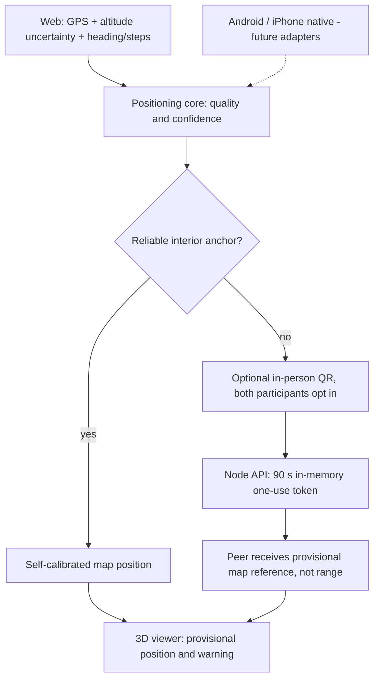

# RetailNav Adaptive Positioning — web end-to-end implementation (v1)

## Invariant

**No hardware installed by the mall.** The positioning service must never need
beacons, mall Wi-Fi, fixed antennas, a surveyed local network or an indoor
positioning vendor. A vector map is still required; an *unverified photograph*
is not a metre-calibrated or georeferenced survey.

The deployed application remains the dependency-free JavaScript/WebGL viewer
with its existing Node.js backend. The **web implementation is wired end to
end** to that production backend. Native Kotlin Multiplatform and the planned
Spring Boot time-series fusion service remain **future integrations**, not
misrepresented as deployed Android/iOS apps.

## Trust model and priority

1. Automatically request browser geolocation **at page startup** (the OS/browser retains control of permissions); expose latitude, longitude, altitude, accuracy and any registered indoor position in the map itself. No manual activation button is needed. The user can explicitly stop the watcher; it stays stopped for that session until they choose to retry. Retain horizontal
   accuracy, altitude, vertical accuracy and freshness separately. Raw GPS
   never leaves the browser through the collaborative protocol.
2. A floor may be proposed by altitude only when *all* are present: a verified
   geodetic datum of WGS84 ellipsoid, surveyed absolute per-floor elevations,
   fresh GNSS data, vertical accuracy ≤2m and an unambiguous likelihood
   (posterior > 0.93). Provisional photo-derived New World City floor heights
   have **none** of these prerequisites. Indoor floor remains unknown.
3. When surveyed floor absolute altitudes and a verified WGS84-to-photo
   affine map transformation are provided, the browser can convert accurate
   GPS latitude/longitude/altitude into a specific indoor X/Y/floor.
   Current Aventura and New World City photographs have no such verified
   calibration and cannot use this mode. The required registration includes
   geographic origin, pixel affine rows, image dimensions and RMS error.
4. A visitor can explicitly set their own point on the chosen floor plan.
   Dead reckoning is opt-in, and only after manual stride-scale + map-heading
   calibration. It stops when error increases. The marker is not GPS.
4. If the visitor lacks a satisfactory indoor reference, they may request
   an anonymous short-lived QR reference **from someone physically next to
   them**. BOTH parties must explicitly opt in. A QR is **not** acoustic/BLE
   ranging: it may be photographed/relayed. The recipient confirms
   co-location, which stays declared and unverified.
5. Physical ranging is an optional future *native* sensor adapter: UWB,
   Wi-Fi RTT/Aware (compatible peers only), BLE RSSI for coarse proximity
   (not metres), calibrated experimental ultrasound (not guaranteed on web).
   WebRTC only exchanges bytes; it never establishes distance by itself.
6. The help session is suspended as soon as it is unnecessary. No
   background microphone recording, Bluetooth scanning or periodic peer
   location broadcast is enabled.

## Current code

- `src/positioning-core.js`: deterministic sensors/accuracy policy,
  GPS altitude uncertainty, optional geodetic floor inference, stale anchor
  safeguards, and ranking of hardware methods.
- `src/indoor-location.js`: opt-in geolocation, heading, manually anchored
  step estimation, peer-reference adoption, marker and estimated accuracy.
- `src/cooperative-positioning.js`: fully wired anonymous QR offer, claim,
  revoke, same-mall validation and explicit UI consent in the existing indoor
  dialog, on mobile Safari and Chromium.
- `backend/server.mjs`: `POST /api/positioning/offer`,
  `POST /api/positioning/claim`, `POST /api/positioning/revoke`.
  Existing session cookie, origin validation, request size and rate limits
  apply to all operations.

## Flow



## API and storage

**Offer request** (`POST /retailnav/api/positioning/offer`) — only for a
fresh manually selected map point; not usable to amplify the uncertain
coordinates of a peer:

```json
{
  "mallId": "new-world-city-shanghai",
  "floor": "L4",
  "x": 600, "y": 280,
  "source": "manual-anchor",
  "observedAtMs": 1791990000000,
  "explicitConsent": true
}
```

The response contains a cryptographically random code, `expiresAt`,
`oneUse:true`, `physicalProximityVerified:false`. The client encodes it
as a URL **fragment** (`#rnp=...`), not in query parameters. It cannot
leak through HTTP request lines or Referer headers.

**Claim request** (`POST /retailnav/api/positioning/claim`):

```json
{
  "code": "<random-one-use-token>",
  "mallId": "new-world-city-shanghai",
  "explicitConsent": true,
  "confirmColocated": true
}
```

The receiver obtains an *unverified, photo-pixel map reference*: floor,
x, y, source `peer-qr-colocation-asserted`, unknown horizontal accuracy,
null distance, `physicalProximityVerified:false`, and a two-minute local
validity window. Codes cannot be used on another mall, by their issuer,
twice or after expiry. Revoke immediately invalidates pending offers.

The reference is stored in **memory only** and discarded automatically
after 90 seconds. The Node presence database contains no positioning
offers, peer observations, GNSS coordinates or permanent proximity graph.
Services are isolated from the existing friend-sharing endpoint.

## Unaddressed realities — explicit controls

- **GPS inside concrete/underground:** positions and altitudes may be
  missing or unreliable; no automatic floor selection.
- **GPS height datum and building elevation:** absolute floor heights
  must be surveyed and expressed in the same vertical datum. The default
  existing floor separation of ~4m is a visual convention, *not* survey
  evidence.
- **GPS drift / stale readings:** measurements over 30 seconds old are
  rejected by the positioning quality evaluator.
- **Peer QR passed remotely:** physical co-location is human-confirmed
  but not cryptographically provable; cannot be treated as precise.
- **Sparse users / no network:** direct manual reference and existing
  opt-in motion fallback remain operable; cooperation requires an online
  server, but no installed mall equipment.
- **Malicious/spoofed reference:** unverified, self-use prohibited,
  one-time code, short-lived, same-mall, authenticated rate-limited
  API. Map registration and independent physical proof are still necessary
  for trusted automatic navigation.
- **Cross-tenant leaks:** the same mallId is checked on offer/claim, and
  peer coordinates are not surfaced in contact lists.
- **Privacy and revocation:** each new device's consent is off by default;
  the offer can be revoked, expires shortly, and user deletion removes
  offers. No precise GPS collection occurs without a specific future
  explicit feature change.
- **Weak sensors / battery:** high-power audio/continuous BLE scanning
  never starts automatically. Web motion and location require activation.
- **Mobile background limits:** suspended web pages cannot promise
  continuous readings; display aging accuracy or manual reference.
- **Browser and OS permissions:** Safari may require a user gesture for
  motion permission, GPS is HTTPS-dependent and can be denied.
- **Site error:** if the mall photo is uncalibrated, show uncertainty
  unknown rather than manufacturing a metre radius.

## Validation

```sh
node --test scripts/test-positioning-core.mjs
node --test backend/server.test.mjs
python3 scripts/build-web.py
node scripts/test-positioning-web-e2e.mjs chromium
node scripts/test-positioning-web-e2e.mjs webkit
```

The browser tests involve real isolated Node sessions, real HTTP offer/claim,
single-use QR and peer location presentation. They do not fake a Bluetooth,
GNSS, microphone or native device measurement.

## Native and centralized fusion work not yet deployed

The longer-term Kotlin Multiplatform engine should implement the same
capability and uncertainty contract with `expect/actual` sensor adapters:
Android SensorManager, CoreMotion on iOS, JS DeviceMotion for web.
Spring Boot + PostGIS + time-series DB can later receive explicitly
authorized, minimized observations to perform map matching and constrained
sensor fusion. Before enabling true multi-peer trilateration, we must build
a device-compatibility lab and measure UWB/RTT/BLE/acoustic error under
real mall conditions. No vendor-agnostic iPhone Safari ultrasound or UWB
distance API can be assumed.

## Automatic position at startup (v2)

The existing application now starts `watchPosition()` immediately upon loading
in compatible browsers, without waiting for opening "Mi ubicación" or pressing
"Detectar shopping". A small, persistent, accessible status on the 3D map shows
when GNSS is searching, available, denied, absent, stale, or stopped. A GNSS
fix reports latitude, longitude, altitude and horizontal/vertical uncertainties
in the location details without sharing them with peers or the server.

**This cannot bypass browser/device permission requests.** Motion sensors on
some Safari devices still require a user gesture to enable. If a browser blocks
geolocation or the user declines permission, the map shows a meaningful state
and preserves the manual positioning path.

* A ground-level or above-ground floor with **verified geodetic coordinates,
  vertical datum and surveyed floor elevations** can automatically appear on
  the 3D map if the GNSS accuracy meets the strict thresholds in the positioning
  core.
* For an uncalibrated mall (including current New World City photographs),
  GNSS can show location/altitude and proximity **but cannot claim an interior
  floor or place a pin on an invented coordinate**.
* "Detener y borrar" clears the local GNSS watch, coordinates and visible
  position; it never auto-restarts after that action within the same page.
* A stale registered GNSS anchor is hidden after 30 seconds without a usable
  update. QR and manual anchors retain their separate provenance.

Automated Chromium and WebKit tests verify immediate startup, accurate
visible GPS state, no fabricated indoor marker, permission-denied/unavailable
fall-backs and explicit stop/retry.
