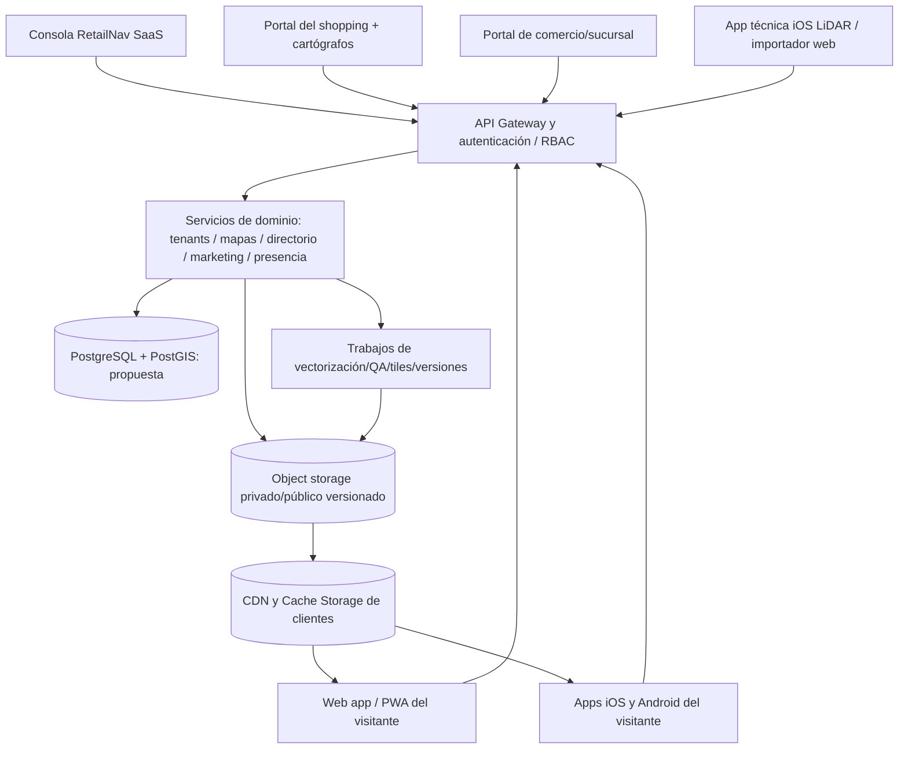

# RetailNav — Documento maestro de producto, arquitectura y ejecución E2E

> **Fuente de verdad funcional para próximos desarrollos y chats.**  
> Proyecto: `romancanoniero/retailnav` | Fecha inicial: **15 de octubre de 2026** | Versión del documento: **1.1**
> **Estado:** arquitectura objetivo y backlog vivo. **No significa que las funciones futuras estén implementadas.**  
> Coordinación: RetailNav SaaS, administradores del shopping, administradores de locales y visitantes web/móvil.

## 0. Instrucciones para el siguiente desarrollador o chat

1. **Leer este documento antes de proponer nuevos módulos.** Leer también `README.md`, `docs/IMPORT-MALLS.md`, `docs/MAP-CACHE-VERSIONS.md` y `docs/ADAPTIVE-POSITIONING.md`.
2. **Inspeccionar el código y el estado real de GitHub/CI** antes de afirmar que algo está implementado. Las ramas de trabajo **no son producción**. No confundir una maqueta, un botón visible o una captura de pantalla con un flujo E2E funcional.
3. Mantener la arquitectura y la experiencia **acumulativas**: no perder polígonos, numeraciones, tiendas, POI, anclajes, rutas, niveles, datos de usuario ni avances de chats anteriores. Crear migraciones y pruebas de regresión antes de reemplazar componentes.
4. Crear rama y PR por épica, con pruebas unitarias, de integración, permisos, navegador real y despliegue. No modificar infraestructura ajena ni eliminar los datos persistentes de Contabo.
5. Al terminar una funcionalidad, **actualizar este archivo**: cambiar estado de sus historias, registrar decisión técnica, endpoints/modelos, pruebas realizadas, migraciones, despliegue y el siguiente paso exacto. Este documento debe permitir **retomar sin redescubrir el proyecto**.
6. Cuando una decisión no está tomada, conservarla en [`17. Decisiones pendientes`](#17-decisiones-pendientes), sin convertir supuestos en requisitos aprobados.
7. **Toda importación de un mall incluye el directorio comercial completo.** Antes de considerarla terminada, aplicar el gate `MAP-17 / DIR-09`: inventariar todos los campos publicados por la fuente, importar logos, categorías, tags y demás información disponible por local, documentar cada ausencia real y hacer fallar la publicación ante cualquier descarte silencioso. Una geometría correcta con un catálogo incompleto es una importación fallida.

**Interpretación del requerimiento:** «administrador del salas» se entiende aquí como **administrador del SaaS RetailNav y sus colaboradores**. Si se refiere a «salas» físicas, agregar ese dominio como épica independiente tras confirmarlo.

---

## 1. Visión, alcance y separación de productos

**RetailNav es un SaaS multi-shopping y multi-comercio**, con mapas interiores 2D/3D, información comercial por planta, búsqueda y navegación interior únicamente cuando el plano esté validado, y una experiencia opcional de visitantes que pueden compartir ubicación con consentimiento.

**Superficies independientes, coordinadas por APIs versionadas:**

| Superficie | Usuarios | Objetivo |
|---|---|---|
| **A. Consola RetailNav (control plane)** | Dueño del SaaS, administradores globales, finanzas, soporte, auditores y colaboradores | Dar de alta shoppings, contratar, habilitar funciones, supervisar datos, permisos, facturación, soporte y operaciones |
| **B. Portal del shopping (tenant admin)** | Dueño/administrador del shopping y colaboradores autorizados | Cargar/validar mapas, gestionar plantas, locales, directorio, conexiones verticales, marca, avisos, publicación y analíticas |
| **C. Portal del local (merchant admin)** | Titular del comercio y personal autorizado | Reclamar/verificar local, administrar su ficha, oferta, productos, promociones, horarios y métricas autorizadas |
| **D. Web app de visitantes (PWA progresiva)** | Visitantes sin registro obligatorio y usuarios con cuenta opcional | Elegir shopping, abrir mapa en caché, buscar, recorrer y opcionalmente ver amigos por consentimiento |
| **E. Apps de visitantes iOS/Android** | Mismos visitantes | Paridad funcional con web y capacidades nativas justificadas; no duplicar reglas de negocio |
| **F. Herramienta de relevamiento técnico** | Cartógrafos/operadores del shopping/RetailNav | Capturar imágenes, LiDAR/ARKit cuando exista, georreferenciar, validar y versionar mapas. Distinta de la app del visitante |

**Reglas estructurales:** un shopping es un `tenant` separado; sus locales y empleados operan sólo dentro de ese tenant. Cada comercio puede tener una o varias unidades físicas; no confundir **marca comercial**, **local físico** y **sucursal**. Una misma empresa puede operar en varios shoppings sin obtener permisos cruzados automáticamente. Los datos del usuario pertenecen a su cuenta, no al shopping, y la presencia/ubicación no se vende ni expone a operadores sin permiso válido.

### 1.1 Lo que NO debemos dar por realizado

- Un plano extraído de fotos o de un visor de terceros **NO es un plano arquitectónico certificado**. La alineación visual de ascensores y los desembarcos de escaleras mecánicas requieren contraste con geometría/levantamiento autorizado.
- Los usuarios DEMO y la selección manual de ubicación **NO son posicionamiento interior real**. GPS, barómetro, UWB, Wi-Fi RTT, BLE, cámaras y ARKit tienen limitaciones, permisos y distinta disponibilidad según dispositivo.
- El prototipo del panel administrativo no implica una gestión multi-tenant lista para explotación comercial. Exige pruebas adversariales, permisos, persistencia, respaldo y restauración.
- Un logo publicado en la web oficial del shopping **no equivale automáticamente a licencia comercial** para reutilizarlo en un SaaS. Registrar fuente y autorización antes de lanzar una implementación contratada.

---

## 2. Inventario verificable del proyecto — fotografía inicial (2026-10-15)

### En `main` / prototipo operativo, según archivos del repositorio

- `public/index.html` construido por `scripts/build-web.py` con `src/page.template.html`, `src/viewer.js`, `src/mall-selector.js`, estilos en `src/style.css`.
- Datos fuente y vectorizados en `data/malls/` y scripts de importación/revisión en `scripts/`. Actualmente hay Aventura Mall, AP Plaza y New World City de Shanghai en el catálogo. Algunos planos son provisionales y deben seguir marcados `navigable: false`.
- Tres plantas de Aventura (LL/UL/L3); nueve plantas fotográficas de New World City; AP Plaza B1. **No asumir que ningún caso está cartográficamente validado in situ.**
- Mapas por shopping versionados, publicados como `public/maps/malls/<mall-id>-<sha256>.json` y comprobados mediante SHA-256 por `src/map-cache.js`. Si no hay versión vigente en Cache Storage, se muestra una pantalla **blanca** con shopping y progreso; el mapa aparece cuando está íntegramente listo. Ver `docs/MAP-CACHE-VERSIONS.md`.
- API Node para identidades anónimas, consentimientos de amigos, fotos, invitaciones QR y referencias de posicionamiento cooperativas: `backend/server.mjs` y pruebas `backend/server.test.mjs`.
- Relevamiento de posicionamiento y limitaciones en `docs/ADAPTIVE-POSITIONING.md`. Los anclajes pueden ser manuales o estimaciones; **nunca atribuirles precisión medida sin evidencia**.
- Publicación web en Contabo bajo `https://improvingyourreality.com/retailnav/`, con despliegue aislado y carpeta persistente separada de releases mediante `deploy/` y GitHub Actions.

### En desarrollo, **no confirmado como producción**

El soporte de **paletas publicadas por shopping, logos y colores de geometría 3D**, con **editor de vista previa local** para visitantes, fue incorporado a `main` en el PR #34. La lista de tokens, fuentes, alcance y pruebas está en `docs/MAP-THEMES.md`. **Aún no está habilitado que un empleado publique el tema para todos los visitantes sin desarrollador.**

La rama `feature/mall-manager-branding` contiene trabajo iniciado para identidad visual individual y portal humano de administración: logos oficiales de Aventura obtenidos desde `aventuramall.com`; `src/mall-theme.js`, `public/admin/`, `backend/mall-admin.mjs` y `backend/mall-geometry.mjs`, más adaptación del catálogo y visor. **Estado: WIP / revisión necesaria; no asumir integración E2E ni merge**. Debe completarse CI, pruebas de seguridad/tenants, migración, despliegue de backend y revisión visual antes de promoción.

### Tabla de estados iniciales

Convención: **[P] prototipo operativo**, **[D] desarrollo parcial**, **[F] futuro**, **[V] validado comercialmente**. Ningún apartado es [V] por defecto.

| ID | Capacidad | Estado | Evidencia/fuente | Próximo criterio |
|---|---|---|---|---|
| SYS-01 | Mapas 3D en navegador, plantas y gestos | [P] | `src/viewer.js` | Pruebas por shopping/dispositivo |
| SYS-02 | Catálogo de varios centros | [P] | `src/mall-selector.js` | Publicación autónoma por tenant |
| SYS-03 | Caché/versiones por shopping | [P] | `src/map-cache.js` | Integrar versiones publicadas por personal |
| SYS-04 | Directorio de locales y búsqueda | [P] parcial | `src/units.js`, datos de mapas | Actualización real, categorías, pertenencia y validación |
| SYS-05 | Amigos, QR y presencia consentida | [P] parcial | `backend/server.mjs`, `src/social.js` | Robustecer múltiples dispositivos/escala y auditoría |
| SYS-06 | Localización interior automática fiable | [F] | `docs/ADAPTIVE-POSITIONING.md` | Calibración + piloto medido |
| ADM-01 | Paleta, fuentes y logo por shopping | [P] valores oficiales y vista previa local; [D] publicación global administrativa | `docs/MAP-THEMES.md`, PR #34; portal `feature/mall-manager-branding` | Publicación autenticada por tenant + E2E de permisos |
| ADM-02 | Portal humano de mapas y locales | [D] | Rama `feature/mall-manager-branding` | E2E de permisos, carga, revisión, publicación |
| ADM-03 | Plataforma SaaS y colaboradores | [F] | Este documento | Identidad y RBAC global |
| MRC-01 | Portal/propiedad del comercio | [F] | Este documento | Reclamo y verificación de sucursal |
| MOB-01 | App iOS/Android de visitantes | [F] | Este documento | Contratos compartidos + beta |
| OPS-01 | Mapeo LiDAR/ARKit por operador | [F] | Este documento | Protocolo de captura y QA físico |

---

## 3. Principios no negociables del diseño

1. **Aislamiento fuerte de tenants:** toda lectura/escritura de mapa, local, factura, empleado, evento, campaña y analítica es autorizada por `tenant_id` desde backend y, donde aplique, por políticas de base de datos. Nunca confiar en un tenant elegido sólo por la URL.
2. **Fuente de datos y procedencia explícitas:** `source_url`/archivo, fecha, aportante, licencia, hash, coordenadas originales, transformaciones, revisión, confianza y responsable.
3. **Identificadores permanentes** de edificio, planta, polígono/local físico, comercio, POI, conexión vertical y revisión. No regenerar IDs porque cambie una etiqueta o se revectorice un borde.
4. **Nada de reemplazar por aproximaciones** lo que ya está vectorizado o alineado. Las nuevas herramientas proponen cambios y muestran una comparación; el humano aprueba cada corrección dudosa.
5. **Borrador, revisión y publicación separados.** Un empleado puede corregir sin alterar inmediatamente lo que el visitante ve. Publicar produce versión inmutable, rollback y registro de quién aprobó.
6. **Integridad atómica:** un mapa no se muestra parcialmente, no se mezclan plantas de versiones diferentes y una descarga fallida no destruye la copia anterior. Metadatos de mapa y branding compatibles con la misma revisión.
7. **Privacidad por defecto:** no inferir ni compartir ubicación interior exacta cuando no exista un fundamento técnico y consentimiento aplicable; permiso del sistema operativo no equivale a consentimiento para compartir.
8. **El operador humano debe poder completar su trabajo desde UI**, sin escribir Python, abrir GitHub ni usar credenciales del servidor.
9. **Accesibilidad y rendimiento** desde el inicio: iPhone/Android, multitáctil, lector de pantalla, reducido movimiento, alto contraste, idioma, conexiones lentas, caché limitada, dispositivos sin WebGL.
10. **Rollback y observabilidad** para cambios de datos, seguridad y software. Nada de modificar datos persistentes de otro proyecto en Contabo.

---

## 4. Arquitectura objetivo y límites entre módulos



**Estrategia evolutiva, no migración obligatoria inmediata:**

- **Hoy:** Node 22 + archivos persistentes JSON y assets + HTML/JS/WebGL + Traefik + Nginx/Contabo.
- **Punto de partida nuevo:** mantener compatibilidad con `backend/server.mjs` y los bundles `retailnav.map.bundle.v1`. Introducir servicios administrativos con almacenamiento persistente y autorización separada de los visitantes.
- **Al alcanzar múltiples shoppings/equipos concurrentes:** migrar con pruebas a PostgreSQL/PostGIS para transacciones, auditoría, geometría, membresías y permisos; object storage para imágenes, capturas, modelos GLB/GLTF/USDZ, tiles y backups. Utilizar migraciones con `up/down`, control de versiones y reversión.
- **No mezclar:** el plano cartográfico publicado es público; borradores, cuentas y fotos privadas no lo son. Nunca añadir tokens o coordenadas de amigos al cache público.
- **Evolución móvil:** valorar **Compose Multiplatform** para UI y lógica compartida Android/iOS/web donde sea viable; los sensores y cámaras usan adaptadores nativos por OS. No imponer el framework antes de probar WebGL/mapas grandes/gestos/accesibilidad en iOS y Android.

### 4.1 Contextos de dominio con propietario único

| Dominio | Fuente de verdad | Responsabilidades |
|---|---|---|
| Identity & Access | IAM/RBAC central | Usuarios administrativos, staff, claims, invitaciones, revocación, sesiones y MFA |
| Tenant & Billing | SaaS | Shoppings contratados, estado de servicio, facturación, límites y permisos de módulo |
| Spatial Mapping | Shopping | Edificio, planta, geometría, corredores, puertas, conexiones, transformaciones, calidad |
| Directory & Merchant | Shopping + comercio según permisos | Sucursales, nombre, número de local, rubros, horarios, etiquetas, publicaciones |
| Branding & Content | Shopping | Logo autorizado, paleta, textos, tipografías seguras, banners y vigencias |
| Publication | Shopping con aprobación | Borrador, aprobación, versión, rollback, assets, invalidación de caché |
| Visitor Identity & Consent | Visitante | Sesión anónima/opcional, amigos, consentimientos y compartición temporal |
| Indoor Positioning | Cliente + servicios autorizados | Sensores, anclajes, incertidumbre, mapas calibrados, privacidad |
| Analytics | Agregaciones mínimas | Búsquedas/clics agregados, campañas y rendimiento; nunca reutilizar datos de amigos |
| Audit & Operations | Operación SaaS | Trazabilidad administrativa, errores, backups, incidentes, métricas técnicas |

---

## 5. Roles, colaboradores y autorización

### 5.1 Matriz de acceso de referencia

| Rol | SaaS/facturación | Shopping/mapas | Comercios | Visitantes/presencia |
|---|---|---|---|---|
| `platform_owner` | Todo + gestión de roles globales | Supervisión con auditoría | Soporte acotado | **Sin acceso** a localizaciones privadas |
| `platform_admin` | Alta/baja tenant, planes, soporte | Supervisión / aprobación si se delega | Moderación escalada | Sin acceso a amistades/posición |
| `platform_billing` | Cobros, facturas, planes | Sin edición | Facturación habilitada | Sin acceso |
| `platform_support` | Tickets mínimos | Diagnóstico con acceso temporal autorizado | Soporte | Sin acceso a datos privados |
| `platform_auditor` | Lectura de logs autorizados | Lectura de revisiones | Lectura autorizada | Sin acceso |
| `mall_owner` | Contrato de su tenant | Admin completo de su mall | Invita comerciantes y delega | Sólo estadísticas agregadas consentidas |
| `mall_admin` | Resumen de plan | Mapas, configuración, publicación | Aprueba fichas y claims | Sin geolocalización de personas |
| `mall_cartographer` | Ninguno | Carga/revisión de geometría y POI | Lectura de referencias | Ninguno |
| `mall_content_editor` | Ninguno | Textos, logo, paleta y contenidos | Validación editorial limitada | Ninguno |
| `mall_marketing` | Solo consumo de créditos | Campañas, promociones y banners aprobados | Moderación de ofertas | Sólo agregados |
| `mall_analyst` | Sin cobros | Sólo informes | Agregados autorizados | No individuos |
| `merchant_owner` | Suscripción comercial si corresponde | Lectura de mapa publicado | Reclamo y gestión de **sus sucursales** | Ninguno |
| `merchant_editor` | Ninguno | Lectura | Ficha, fotos, horario, tags | Ninguno |
| `merchant_marketing` | Ninguno | Lectura | Ofertas y campañas propias | Sólo agregados |
| `visitor_anonymous` | No aplica | Mapa público | Búsqueda y ficha | Su identidad/consentimientos propios |
| `visitor_registered` (opcional) | No aplica | Mapa público | Preferencias autorizadas | Sus datos propios y compartir con amigos |

**Obligatorio:** modelo RBAC + ámbito `tenant_id` y, para comercio, `merchant_id` y `store_unit_id`. Los roles son permisos del servidor; ocultar botones no constituye protección.

### 5.2 Gestión de colaboradores — historias obligatorias

- **IAM-01** Invitación al email o canal elegido; token de un solo uso, caducidad, reenvío, cancelación y aceptación.
- **IAM-02** Personal asignado a uno o varios shoppings con roles distintos sin privilegios heredados implícitamente.
- **IAM-03** Usuario colaborador sólo ve los shoppings y las sucursales expresamente autorizados.
- **IAM-04** MFA/2FA obligatorio en cuentas con capacidad de publicar, facturar o modificar permisos.
- **IAM-05** Baja o suspensión de un colaborador revoca sesiones y tokens inmediatamente.
- **IAM-06** Registro de acciones `quién / qué / tenant / entidad / versión / fecha / IP de seguridad limitada / resultado`, con retención y protección legal definidas.
- **IAM-07** Acceso de soporte excepcional: solicitud, justificación, consentimiento del tenant, tiempo máximo, alcance limitado y auditoría. **Prohibida la suplantación silenciosa.**
- **IAM-08** Recuperación de acceso y transferencia de titularidad en ausencia del administrador original, con doble verificación.
- **IAM-09** Separación de sesiones: administrador != visitante; tokens scoped, CSRF/origin checks, rate limit, cookies seguras, protección XSS y uploads peligrosos.

---

## 6. Módulo A — Administración del SaaS RetailNav

### A.1 Funciones requeridas

**PLAT-01 — Onboarding comercial:** alta de shopping, razón social, contacto, país/moneda/zona horaria, sedes, tenant estable, estado `prospecto -> demo -> contratado -> suspendido -> baja`, origen del alta, contratos y prueba. **No auto-habilitar producción por sólo crear un registro.**

**PLAT-02 — Planes:** límites configurables de plantas, sucursales, colaboradores, ancho de banda/almacenamiento, frecuencia de publicación, personalización, APIs, analíticas, campañas y soporte. La asignación de permisos se implementa mediante `entitlements`, no condicionales hardcodeados en cada pantalla.

**PLAT-03 — Colaboradores internos:** roles de la matriz, invitaciones, revocación, delegación y auditoría. Un comercial no es administrador técnico; una persona de soporte no puede modificar facturación.

**PLAT-04 — Contratación y facturación:** prueba, renovación, facturas, impuestos locales, medios de pago y deudas. Proveedor de pagos todavía por decidir. Idempotencia de webhooks; cobros fallidos no deben borrar mapas ni datos.

**PLAT-05 — Control de calidad:** tablero de mapas pendientes, tasa de polígonos sin nombre, anclajes sin confirmar, fotos sin licencia, conexiones entre plantas no verificadas, revisiones publicadas, incidentes.

**PLAT-06 — Operación:** salud API, tiempos de carga, errores JS, volúmenes de tiles/mapas, versiones por tenant, expiraciones de dominio/certificados, disponibilidad de Copias de Seguridad.

**PLAT-07 — Soporte:** casos, evidencias y logs técnicos no sensibles, solicitud de autorización temporal para investigar; sin lectura libre de amigos/ubicación.

**PLAT-08 — Contratación de comercios:** habilitar el portal merchant y política de atribución: shopping cobra, RetailNav cobra al comercio o modelo mixto; tasas y facturación por tenant.

### A.2 Flujo E2E PLAT-J01: del contrato al primer admin del shopping

1. Operador global crea `tenant` en **borrador** y asigna plan/prueba.
2. Se validan dominio, nombre comercial, administrador responsable y datos fiscales mínimos pertinentes.
3. Se envía invitación al futuro `mall_owner`; esa persona acepta, define contraseña/MFA y recibe acceso exclusivamente a su tenant.
4. El SaaS activa `entitlements` acordados y cupos.
5. El owner abre su portal, configura marca, crea o importa su primer edificio y delega cartografía/comercios.
6. Un auditor ve un registro completo del proceso; ningún tercero puede listar o descargar borradores.
7. No hay versión pública hasta revisión y publicación explícita.

**Aceptación:** tenant A no puede leer o editar tenant B cambiando parámetros, cookies, URL, IDs ni exportaciones. Suspensión de cobro conserva versiones y da acceso de lectura/transición según contrato. Probar invitaciones expiradas y repetidas.

---

## 7. Módulo B — Shopping: configuración, mapas, plantas y personal

Este es el módulo con mayor trabajo cartográfico. Debe funcionar para un empleado no técnico desde el navegador.

### B.1 Identidad visual y contenido

- **MALL-01** Logo principal y variante pequeña; validación MIME real y dimensiones; modo claro/oscuro y vista previa móvil. SVG de terceros sólo si es revisado/sanitizado por pipeline seguro y existen derechos de uso.
- **MALL-02** Paleta por shopping: fondo, superficie, texto, texto secundario, acento, texto sobre acento, bordes; mapa 3D (locales, anclas, pasillos, zonas, losas y líneas). Variables y tipografías de lista blanca. **Verificación WCAG de contraste** y legibilidad al hacer zoom.
- **MALL-03** Fuentes predeterminadas seguras, radio de bordes, tamaños y estilo de etiquetas/pines; vista previa sin publicar.
- **MALL-04** Nombre, ciudad, idiomas, teléfono, horarios, descripción, enlaces, normas y categorías. Cada traducción con idioma y revisión.
- **MALL-05** Historial de marca, aprobación, reversión y marca asociada a una versión de contenido.

**Aventura Mall:** se encontraron en la fuente oficial `https://aventuramall.com/` sus logos `/wp-content/uploads/2025/01/logo.svg` y `logo-2.svg`; la investigación de colores del sitio mostró negro cálido `#17150f`, blancos, arenas `#f3efe6` y `#e1d9c9` entre otros. Los recursos se importaron a la rama en desarrollo; verificar licencia/permiso antes de uso comercial. **Nunca aplicar esta paleta a otros shoppings por defecto.**

### B.2 Alta/importación de un nuevo shopping y sus plantas

- **MAP-01** Wizard: nombre/edificio -> lista de plantas -> fuentes -> escala/orientación -> referencias -> revisión -> publicación.
- **MAP-02** Cargar PNG/JPEG/WebP/PDF, archivos vectoriales/GeoJSON/GLB/GLTF/USDZ cuando haya parser autorizado. Registrar fuente, hash, licencia, resolución, planta, autor y fecha. No aceptar archivos ejecutables disimulados.
- **MAP-03** Fotografía oblicua: corrección de perspectiva con cuatro esquinas confirmadas; preservar siempre imagen original y transformación; no confundir tamaño de imagen con metros del edificio.
- **MAP-04** **Primera fase 2D obligatoria:** superponer segmentos/contornos editables y número visible para que el operador confirme cada local/área. Sólo después triangulación/3D.
- **MAP-05** Segmentación híbrida y revisión asistida por IA opcional: sugerencias de paredes, puertas, tiendas y textos; cada detección guarda evidencia/confianza; ninguna sospecha modifica automáticamente el mapa aprobado.
- **MAP-06** Trabajar en coordenadas canónicas por planta; soportar múltiples edificios, sótanos, entrepisos y puentes. Cada piso tiene `floor_id`, orden, cota opcional, tamaño, sistema de referencia y transformación.
- **MAP-07** **Registro entre plantas:** utilizar anclas estables (ductos de ascensores, núcleos rígidos, escaleras, fachada/columnas). Conservar misma escala y orientación geoespacial. Comparador **amarillo / rojo / azul**, con opacidad y diferencia de contornos. Un conducto de ascensor puede coincidir en X/Y; una escalera mecánica puede tener desembarcos **desplazados**.
- **MAP-08** Alineación con estimación cuantitativa de error, cantidad de anclas, discrepancias, procedencia y aceptación humana. Prohibido deformar una planta solo para lograr coincidencia visual.
- **MAP-09** Conectores `elevator / escalator / stairs / ramp` con entradas, salidas, accesibilidad, dirección, restricciones y pisos; relaciones verificadas antes del algoritmo de rutas.
- **MAP-10** Identificadores comerciales impresos en plano: extraer y almacenar como **texto asociado al polígono**, no convertir números en agujeros o superficies vacías. Distinguir ID local físico, código de tienda, nombre comercial.
- **MAP-11** Rectificación/rerevisión sin pérdida: versionar geometría, comparar IoU, cambios de vértices, contornos y anclajes; preservar ID y datos vinculados al polígono. Reporte de diferencias para aprobación.
- **MAP-12** Captura técnica móvil: operador iPhone con LiDAR/ARKit + cámara, sesiones por planta, tracking/SLAM, checkpoints conocidos, metadatos de dispositivo y error. La ausencia de LiDAR o de visión estable debe marcar una sesión incompleta.
- **MAP-13** Exportación optimizada (vectores 2D, render 3D/WebGL, GLTF/GLB/USDZ) sin cargar innecesariamente otras plantas ni degradar dispositivos móviles.
- **MAP-14** QA antes de navegación: senderos transitables, puertas, escala en metros, conectores verticales, obstáculos, accesibilidad, emergencias, precisión y verificación sobre el terreno. Hasta ese hito, `navigable: false`.
- **MAP-15** Publicación semántica y atómica `vN`: manifest, hash, esquema, tamaños, assets, cambios/rollback, caché de mapas por mall y estado de validación.
- **MAP-16** Cuando un mapa se actualiza, mantener compatibles las fichas de tiendas y POI por ID, o exigir una tabla explícita de migración de IDs; nunca eliminar información comercial por dibujar de nuevo.
- **MAP-17** **Gate de completitud del directorio:** cada importación genera una matriz por campo y local con `published / imported / missing / invalid`, procedencia e IDs afectados. La publicación se bloquea si omite un dato que la fuente oficial ofrece, si no archiva un logo oficial válido, si deja tags vacías para una categoría publicada o si una ausencia carece de motivo verificable. Nunca inventar datos para hacer pasar el gate.

### B.3 Administración de locales y servicios

- **DIR-01** Directorio con código/número, piso, polígono, ubicación/entrada, comerciante operador, rubro, tags, marca, horarios, accesibilidad, teléfono y fuente de validación.
- **DIR-02** Importación manual/CSV/API oficial; previsualizar conflictos `alta / actualización / local no encontrado / número duplicado`, resolver y hacer commit. No inventar nombres.
- **DIR-03** Nombres públicos y categorías revisados por el shopping. Cada local debe disponer de al menos **estado explícito**: sin nombre, pendiente, verificado, cerrado, temporal.
- **DIR-04** Procesos para locales vacíos, quioscos, ferias, islas, food hall, diferentes ocupantes en el mismo espacio y marcas con más de una unidad.
- **DIR-05** POI no comerciales: baños, ascensores, escaleras, salidas, parking, información, lactancia, accesibilidad, salas/servicios si existen; categoría, verificabilidad, fuente, horarios y coordenadas.
- **DIR-06** Fichas reclamables por un comercio, sujetas a verificación (véase módulo C).
- **DIR-07** Buscador por nombre, código, categoría, producto/actividad, sinónimos e idioma con ranking trazable; no redirigir a un comercio equivocado por asociación aproximada.
- **DIR-08** Cambios operativos temporales: escalera cerrada, planta restringida, obras, local cerrado, ruta inaccesible. TTL, fecha y prioridad por seguridad.
- **DIR-09** Contrato mínimo de importación por local: ID/código, planta, nombre, estado, categoría original, tags/conceptos con evidencia, logo con URL/hash/estado, descripción, contacto, web/redes, horarios, servicios/accesibilidad, marcador/coordenadas, vínculo espacial y procedencia. Se exige cada campo que la fuente publique; lo no publicado o roto queda explícitamente `unavailable`/`invalid` con causa, nunca vacío por omisión.

### B.4 Equipo humano y control editorial

- **STAFF-01** El `mall_owner` invita cartógrafos, responsables de locales, contenido, analistas y marketing.
- **STAFF-02** Edición por secciones y/o plantas delegadas; edición concurrente con `revision`/ETag y rechazo de conflictos (`409`).
- **STAFF-03** Flujo `draft -> in_review -> changes_requested -> approved -> published -> archived` con aprobadores, evidencia y comparación de revisiones. Separación opcional entre quien edita y quien aprueba.
- **STAFF-04** Historial/rollback por shopping sin afectar a otro tenant.
- **STAFF-05** Exportación e importación de respaldo, con validación de schema, ID tenant y vista previa; ningún JSON importado debe poder elevar roles ni inyectar HTML/JS.

### B.5 Flujo E2E MALL-J02: plano nuevo a publicación

1. Cartógrafo sube foto/plano original de `L2` con procedencia y licencia.
2. Operador fija tamaño, orientación, correspondencia con anclas/otras plantas y sistema de referencia.
3. Importador genera contornos **candidatos 2D**, números y servicios; empleado revisa y corrige.
4. Supervisor compara foto y contornos, incluye errores, comprueba conexiones entre plantas.
5. Shopping vincula nombres/categorías de comercios por número/ID sin asociaciones especulativas.
6. El importador recorre el directorio oficial completo y preserva por local todos los campos publicados: logos, categoría original, tags/conceptos, descripción, contacto, web/redes, horarios, servicios, accesibilidad y procedencia, además de los datos espaciales.
7. El gate `MAP-17 / DIR-09` compara fuente y salida por campo; toda omisión bloquea la publicación. Los datos no publicados o assets rotos quedan identificados con causa; no se inventan.
8. Se ejecutan reglas de QA; si falta escala, puertas o conectores, el mapa se publica **sólo como vista provisional**, sin prometer rutas reales.
9. Aprobación genera un bundle inmutable y su manifest; web/móvil comprueba caché y descarga nueva versión con pantalla blanca y progreso.
10. Prueba de regresión: mismos ID, locales, conexiones verificadas, buscador, imágenes, logos, categorías, tags, demás datos comerciales, gestos, etiquetas y amigos autorizados.
11. Si la nueva versión da error, se restaura la versión previa; auditoría conserva ambas.

**Aceptación E2E:** mismo shopping con dos revisiones, dos usuarios, un cartógrafo y aprobador, conflicto de edición, un archivo inválido, una descarga interrumpida, cierre de aplicación y vuelta sin redescargar la versión vigente. Tenant ajeno no puede abrir borradores.

---

## 8. Módulo C — Administración de comercios y sucursales

**Separación indispensable:** `merchant` es la empresa/marca; `store_unit` es el local físico dentro de un shopping; `listing` es su ficha visible; `promotion` es una publicación con vigencia.

- **MRC-01** Flujo de **reclamo de local**: seleccionar unidad, comprobar titularidad mediante código del shopping/contrato/correo corporativo/documento aprobado manualmente; `pending -> verified/rejected -> revoked`.
- **MRC-02** La administración del shopping confirma o rechaza el reclamo; no basta con conocer un número de local.
- **MRC-03** Titular del comercio agrega colaboradores con permisos de contenido, horarios, promociones o analíticas. Un empleado de la sucursal A no edita sucursal B.
- **MRC-04** Editar nombre público, descripción, fotos/logos autorizados, categoría, productos/servicios, tags y sinónimos, teléfonos, web y horarios. Validar URL, moderar uploads y respetar directorio oficial.
- **MRC-05** Distinción de campos: el comercio edita información comercial; **no edita geometría, piso o puerta** sin solicitud de corrección al shopping.
- **MRC-06** Promociones, eventos, ofertas, cupones, banners y vigencia, con políticas por plan y revisión/manejo de publicidad.
- **MRC-07** Dashboard agregado: impresiones, búsquedas que encontraron el comercio, clics a ficha, rutas iniciadas y campañas; sin ofrecer datos de identidad o trayectorias individuales no consentidos.
- **MRC-08** Suspensión, cambio de operador del local y fin del contrato sin borrar historial cartográfico ni apropiarse de datos ajenos.
- **MRC-09** Suscripciones/métricas comerciales: decidir si RetailNav factura directo o a través del shopping; recibos, pagos y comisiones trazables.
- **MRC-10** Horarios especiales, cierres temporales y promociones de temporada, visibilidad y caducidad automáticas.

### Flujo E2E MRC-J03: reclamar y operar un local

1. Shopping tiene unidad `UL-203` aprobada y sin reclamo.
2. Comerciante solicita control mostrando evidencia.
3. Shopping aprueba; SaaS crea vínculo `merchant ↔ store_unit` temporal y auditable.
4. Comerciante actualiza rubros y horario; shopping aprueba contenido cuando la política lo exige.
5. Visitante busca «zapatillas» y ve ese local por tags; la ruta sólo se ofrece si el mapa tiene navegación validada.
6. El comercio programa una promoción; la campaña aparece/desaparece en fecha prevista y se registra una métrica agregada.
7. Tras revocación del claim, los editores pierden acceso inmediatamente y permanece la ficha oficial del shopping.

**Aceptación:** evitar secuestro de fichas por códigos públicos, IDOR, imagen maliciosa, fuga cross-tenant, promociones vencidas, facturación duplicada y edición de sectores cartográficos por vendedores.

---

## 9. Módulo D — Web app de visitantes

### D.1 Entrada, búsqueda y caché

- **USR-01** Elegir shopping explícitamente; sugerencia por ubicación sólo con permisos y precisión suficientes. Mostrar qué shopping está cargado.
- **USR-02** Consultar **primero la versión del mapa en Cache Storage**; si es válida, mostrarlo sin descarga de geometría. Si falta o cambió, capa **blanca**, shopping, estado/progreso real y reintento; revelar vista sólo tras preparación/render completos.
- **USR-03** Cache por mall, hash, versión y esquema; rechazo de bundle corrupto; no mezclar niveles ni mapas entre centros; cuota de almacenamiento y política de expiración explícitas.
- **USR-04** Buscador global del shopping por local, número, producto, categoría, sinónimos y servicios; resaltar planta/destino sin perder vista general.
- **USR-05** Zoom, rotar, pan, gestos de dos dedos, planta individual/todas, perspectiva 2D/3D, leyenda y botones accesibles.
- **USR-06** Mostrar etiquetas en geometría vectorizada: los códigos de tiendas son datos, no agujeros. Priorizar nombres y permitir ocultar capas para rendimiento.
- **USR-07** Fichas de local con datos validados, campañas, horarios y acceso a rutas cuando sea apropiado.
- **USR-08** Sin conexión: mapa almacenado, búsqueda local y UI mínima offline si se instala una PWA/Service Worker. **Actualmente el caché de geometría no garantiza que todo el shell web funcione sin Internet**.
- **USR-09** Compartir enlace a shopping/local/planta sin filtrar datos privados ni incluir tokens en query strings.
- **USR-10** Estados vacíos y recuperación ante errores: shopping inexistente, falta de permisos, WebGL no disponible, planta no validada, mapa grande, internet inestable.

### D.2 Navegación interior

- **NAV-01** Ruta sobre grafo de pasillos, accesos de tiendas, conexiones verticales verificadas y restricciones de accesibilidad. No usar líneas rectas atravesando locales.
- **NAV-02** Origen declarado, automático sólo si existe precisión interior suficiente y calibración; mostrar incertidumbre.
- **NAV-03** Rutas accesibles (ascensores/rampas), evitar escalera mecánica o escalones, indicar planta y cambios.
- **NAV-04** Actualización si cierre temporal, incidencia o mapa versionado; recalcular sin mezclar revisiones.
- **NAV-05** Turn-by-turn sólo tras prueba presencial de exactitud; en prototipo mantener «ruta demostrativa» y disclaimer claro.
- **NAV-06** Rutas alternativas, tiempo y distancia únicamente si escala y velocidades están fundamentadas.

### D.3 Personas y privacidad

- **SOC-01** Continuar sesión anónima sin registro obligatorio y recuperación voluntaria; cuenta opcional sin degradar anonimato.
- **SOC-02** Agregar amigos por QR recíproco o link de consentimiento; token de un uso, caducidad, bloqueo y eliminación del vínculo.
- **SOC-03** Elegir **quién** puede ver presencia, durante cuánto tiempo y en qué shopping; revocación y expiración automáticas.
- **SOC-04** Mostrar amigos en mapa/lista con foto real sólo si el usuario la compartió y autorizó; los DEMO deben estar inequívocamente separados de reales.
- **SOC-05** Compartir ubicación interior únicamente con anclaje fiable o con clara etiqueta «manual/estimada». No asumir ubicación física por tener GPS encendido.
- **SOC-06** Modo grupo/encuentro opt-in, estado de llegada voluntario, expiración; sin seguimiento silencioso de visitantes.
- **SOC-07** Exportar/borrar datos de usuario, fotos y contactos conforme a políticas de privacidad y exigencias legales.

### Flujo E2E USR-J04: llegada, búsqueda, compra y regreso

1. Visitante abre `?mall=aventura`: HTML/catálogo identifica tenant y bundle vigente.
2. Si la versión está cacheada y es íntegra, muestra mapa; de lo contrario descarga completamente con la capa blanca y progreso.
3. Busca categoría/producto o nombre y elige una tienda. Se resuelve `store_unit_id` y su planta sin inventar geometría.
4. Visor enfoca el local; si hay grafo calibrado, ofrece ruta accesible según preferencias; si no, sólo resalta el destino.
5. Puede abrir la ficha y, si autorizó, ver una promoción vigente. Sin rastrear navegación individual por defecto.
6. Cierra y vuelve a abrir: conserva mapa sin segunda descarga; si hay una versión nueva, actualiza atómicamente.
7. Si está offline, presenta la última versión válida y comunica expresamente posibles datos desactualizados; funcionalidades que requieren servidor aparecen inactivas.

---

## 10. Módulo E — Apps móviles y módulo de relevamiento

### E.1 App del visitante iOS/Android

**MOB-01** Paridad de funciones: shopping, descarga/versionado, mapa 2D/3D, búsqueda, fichas, rutas validadas, amigos, privacidad y accesibilidad.

**MOB-02** Arquitectura compartida de modelos/API, no WebView ciega: evaluar Compose Multiplatform/otro framework por rendering, gestos, tamaño de descarga, offline, accesibilidad y mantenimiento. La app consume los **mismos IDs, permisos y versiones** del portal web.

**MOB-03** Almacenamiento offline con manifiestos firmados/hash, migración de esquema, cuotas, limpieza por shopping, recuperación tras app suspendida y reanudación/descarga parcial cuando se implemente soporte HTTP adecuado.

**MOB-04** Geolocalización/sensores mediante adaptadores nativos: GPS, altitud/barómetro, brújula, IMU/step count, cámaras cuando proceda. Detectar hardware compatible; nunca anunciar posicionamiento interior garantizado.

**MOB-05** Notificaciones push de eventos opt-in: avisos importantes, amigo cercano (con consentimiento), recordatorios de encuentro, promociones según intereses/permisos. Frecuencias y silenciamiento configurables, protección contra spam.

**MOB-06** Universal/deep links y QR; preservar contexto entre web/app, incluso después de instalación.

**MOB-07** Autenticación opcional y sincronización sin perder la cuenta anónima. Integración de recuperación / multi-dispositivo con consentimiento.

**MOB-08** Términos, privacidad, transparencia de permisos, revisión App Store y Google Play, métricas de fallos y QA de dispositivos.

### E.2 App de cartografía/relevamiento — producto distinto

**SCAN-01** iPhone con LiDAR/ARKit cuando el hardware lo permita; cargar/sincronizar sesiones por shopping y planta, puntos de control, observaciones y fotos.

**SCAN-02** Datos locales seguros durante pérdida de conexión; reanudación y subida autenticada cifrada. Restricción estricta a operador habilitado.

**SCAN-03** Colaboración con dos operadores: detectar solapamientos y drift, fusionar sólo registros compatibles, reconciliar geometría en servidor sin perder identificadores aprobados.

**SCAN-04** Verificación de escala, altura entre plantas, posición de ascensor, conexiones de escaleras, rampas, puertas y recorridos realmente transitables. Reporte de incertidumbre y «no medido» visible.

**SCAN-05** Pipeline que entrega propuestas al portal del shopping; el admin **aprueba**, nunca la app pública del visitante.

---

## 11. Contratos de datos y persistencia objetivo

**No implementar nuevas tablas sin versionar primero este contrato.**

### 11.1 Entidades mínimas

| Entidad | Clave | Relaciones y campos mínimos |
|---|---|---|
| `tenants` | `tenant_id` UUID | nombre, estado, país, moneda, plan, política de retención |
| `mall_sites` | `mall_id` UUID + `slug` único | tenant, nombre, ciudad, geo exterior, edificios, branding_version |
| `tenant_memberships` | `membership_id` | user_id, tenant_id, role, scopes, estado, timestamps |
| `merchants` | `merchant_id` | empresa, titularidad, estado, facturación |
| `merchant_memberships` | `membership_id` | user_id, merchant_id, roles y store scope |
| `buildings` | `building_id` | tenant_id, mall_id, geometría exterior y zonas |
| `floors` | `floor_id` | building_id, código, orden, elevación y datums cuando estén medidos |
| `map_revisions` | `map_revision_id` | mall_id, parent_revision, schema_version, hash, status, autor, aprobador |
| `map_assets` | `asset_id` | tenant_id, hash, mime, tamaño, ruta privada/publicada, licencia y procedencia |
| `geo_features` | `feature_id` | floor_id, tipo, geometría, nivel de verificación, versión y origen |
| `store_units` | `store_unit_id` | mall_id, floor_id, feature_id, código/número, entrance_id, estado |
| `store_occupancies` | `occupancy_id` | store_unit_id, merchant_id, vigencia desde/hasta, evidencia |
| `listings` | `listing_id` | store_unit_id, textos por idioma, categoría, tags, horarios, publicación |
| `vertical_connections` | `connection_id` | tipo, desde/hasta por planta y puntos de desembarco distintos, accesibilidad |
| `pois` | `poi_id` | tenant, floor, tipo, coordenadas y source_status |
| `themes` | `theme_version_id` | tenant/mall, paleta, logo y fonts aprobados |
| `releases` | `release_id` | mall_id, map_version, directory_version, theme_version, manifest_sha |
| `publication_history` | `event_id` | qué versión, autor, aprobador, motivo, rollback |
| `claims` | `claim_id` | merchant, store_unit, evidencia, estado, verificador |
| `campaigns` | `campaign_id` | merchant/store_unit, contenido, reglas, vigencia, aprobación |
| `users` / `consents` / `friendships` | UUID por dominio | privacidad, expiry, relación y revocación |
| `audit_events` | `event_id` | actor, scope, acción, recurso, request_id, revisión, resultado |

**IDs internos** no dependen del nombre, número de local ni URL. Los identificadores externos (por ejemplo RoveIQ `loc_id`) se guardan en tabla de **referencias externas** (`source_system`, `external_id`, `internal_id`), con índice y unicidad por fuente/contexto.

### 11.2 Contrato de una versión pública de mapa (conceptual)

```json
{
  "schema": "retailnav.map.manifest.v2",
  "tenantId": "tenant-uuid",
  "mallId": "mall-uuid",
  "slug": "aventura",
  "releaseId": "release-uuid",
  "mapVersion": "<sha256>",
  "directoryVersion": "<sha256>",
  "themeVersion": "<sha256>",
  "publishedAt": "ISO-8601",
  "navigable": false,
  "spatialQuality": "provisional",
  "floors": [
    {
      "floorId": "stable-floor-uuid",
      "code": "UL",
      "order": 2,
      "assets": [
        {"type": "geojson", "url": "same-origin-immutable-url", "sha256": "<sha256>"}
      ],
      "referenceSystem": {
        "type": "photo-pixels",
        "width": 1400,
        "height": 900,
        "metersPerPixel": null,
        "transformToMall": null,
        "rmsErrorMeters": null
      }
    }
  ],
  "assets": [],
  "license": {"status": "pending-human-verification"}
}
```

El esquema anterior es **propuesta v2**, no describe literalmente el bundle productivo `retailnav.map.bundle.v1`. Implementar **migrador explícito**, esquema JSON versionado y tests de retrocompatibilidad. No romper URLs/cache actuales hasta que exista una capa de lectura dual.

### 11.3 Reglas de consistencia fundamentales

- Cambio de color **no debe redefinir coordenadas**, IDs ni destruir el mapa caché. Mantener versiones de estilo y geometría separadas cuando el cliente lo soporte.
- Renovar únicamente fichas/horarios/promociones no debería obligar a descargar de nuevo el GLB o todos los polígonos; desacoplar versiones en manifest v2.
- Geometría de escalera conecta **dos desembarcos**; no presupone misma X/Y en pisos distintos. Ascensor puede usar mismo núcleo pero accesos distintos.
- `features` de zonas no implican automáticamente unidades comerciales. Relación `store_unit ↔ feature` puede estar pendiente, y esto debe representarse en UI y búsqueda.
- Fotos, capturas y uploads privados no deben quedar accesibles por URL pública antes de revisión/publicación.
- Toda publicación debe ser reproducible a partir del borrador aprobado + pipeline fijo + hashes.

---

## 12. API pública/administrativa: propuesta versionada

**Convención propuesta:** prefijo `/api/v1` para módulos nuevos. La API actual `/retailnav/api` sigue funcionando mediante compatibilidad/migración. Estos endpoints son **objetivos**, no una afirmación de que existen.

| Grupo | Operaciones (ejemplos) | Autoriza |
|---|---|---|
| `/v1/platform/tenants` | listar/crear/suspender/plan | owner/admin SaaS |
| `/v1/platform/users` | invitar y asignar roles globales | admin SaaS |
| `/v1/tenants/:tid/members` | invitar, editar rol y revocar | mall owner/admin con scope |
| `/v1/tenants/:tid/malls/:mid` | editar shopping | mall owner/admin |
| `/v1/tenants/:tid/malls/:mid/themes` | subir logo, editar, previsualizar, aprobar | contenido/admin shopping |
| `/v1/tenants/:tid/malls/:mid/maps/imports` | imágenes/mapas, jobs, reports | cartógrafo |
| `/v1/tenants/:tid/malls/:mid/floors` | CRUD de plantas/transformaciones | cartógrafo |
| `/v1/tenants/:tid/malls/:mid/features` | polígonos/anclajes/puertas | cartógrafo |
| `/v1/tenants/:tid/malls/:mid/connectors` | ascensores/escaleras/rampas | cartógrafo |
| `/v1/tenants/:tid/malls/:mid/directory` | unidades y POI, validación CSV | admin/contenido |
| `/v1/tenants/:tid/malls/:mid/revisions` | diff, QA, solicitar revisión y aprobar | scopes separados |
| `/v1/tenants/:tid/malls/:mid/releases` | publicar, historial, rollback | aprobador/publicador |
| `/v1/merchants/:merchantId/claims` | reclamar unidad, revisar evidencia | dueño/comercio + shopping |
| `/v1/merchants/:merchantId/units/:unitId` | ficha, fotos, horarios, tags | rol sobre sucursal |
| `/v1/merchants/:merchantId/campaigns` | crear/moderar/publicar promoción | comerciante + reglas shopping |
| `/v1/public/malls/:slug/manifest` | versión publicada, geodatos, marca | público, caché controlado |
| `/v1/public/malls/:slug/directory` | buscar/ficha/horarios publicados | público |
| `/v1/visitors/me` | identidad opcional/consentimientos | usuario actual |
| `/v1/visitors/friends` | QR/invitar/aceptar/revocar | usuarios autorizados |
| `/v1/visitors/presence` | compartición opt-in/TTL | usuario y amigos permitidos |
| `/v1/analytics/aggregates` | métricas agregadas con umbrales | roles autorizados |
| `/v1/audit/events` | consultar log en scope permitido | auditoría |

**Requisitos comunes:** bearer/cookie según canal con protección CSRF; `X-Request-ID`, scopes efectivos en middleware y repositorio; validación contra JSON Schema; paginación; `If-Match`/ETag en edición; idempotency-key para cobros/publicaciones; límites de tamaño; respuesta estructurada de errores y códigos 401/403/404/409/422/429.

**Eventos internos propuestos:** `tenant.created`, `membership.revoked`, `map.imported`, `map.review_requested`, `map.approved`, `release.published`, `release.rolled_back`, `store.claim_approved`, `merchant.listing_changed`, `campaign.activated`. Consumidores deben ser idempotentes y eventos versionados.

---

## 13. Journeys E2E transversales y pruebas obligatorias

| ID | Escenario | Validación inequívoca |
|---|---|---|
| E2E-01 | Dueño SaaS crea shopping, invita owner | Invitación segura, MFA y tenant creado una sola vez |
| E2E-02 | Shopping owner invita 2 colaboradores con roles distintos | Editor no publica ni cambia permisos; cartógrafo no ve facturas |
| E2E-03 | Shop A intenta abrir recurso privado de Shop B | HTTP 403/404 + auditoría; ningún dato filtrado en payload |
| E2E-04 | Cartógrafo sube foto, traza 2D, guarda borrador | Geometría estable, previsualización y no publicación accidental |
| E2E-05 | Corrige planta L2 sobre mapa antiguo | Mismos códigos y IDs, anclajes comparables, diferencia registrada |
| E2E-06 | Dos empleados editan la misma revisión | Segundo recibe conflicto y comparación, no sobreescribe |
| E2E-07 | Reviewer rechaza un enlace de escalera dudoso | `navigable: false`, no dibujar ruta falsa, incidencia trazada |
| E2E-08 | Aprueba/publica versión N+1 del shopping | Hash íntegro, subida completa, caché sólo de ese mall actualizada |
| E2E-09 | Visitante reinicia en iPhone sin actualización | Caché hit, sin descargar mapa, mismas etiquetas y piso |
| E2E-10 | Descarga se interrumpe o se corrompe | Pantalla blanca/error/reintento, mapa viejo seguro conservado |
| E2E-11 | Cambia Aventura -> New World -> Aventura | Sin mezcla de niveles, unidades, POI, amigos ni temas |
| E2E-12 | Shopping modifica paleta y logo | UI y 3D de ese tenant cambian; geometría/códigos intactos |
| E2E-13 | Empleado intenta subir SVG malicioso/HTML | Rechazo por MIME/contenido, sin ejecución/script |
| E2E-14 | Comerciante reclama unidad de otro shopping | Claim queda pendiente; no puede apropiarse de unidad |
| E2E-15 | Titular comercio edita tags/campaña | Sólo sucursal autorizada, moderación y fechas correctas |
| E2E-16 | Visitante busca producto y abre tienda | Coincidencia con unit ID verificado, no centro equivocado |
| E2E-17 | QR amistad, revocación y caducidad | Ambos consienten, un solo uso, sin exposición pública de ubicación |
| E2E-18 | Usuario rechaza GPS/sensor o pierde señal | Sin posición interior falsa; buscar y navegar manualmente |
| E2E-19 | Publicación defectuosa y rollback | Versiones anteriores recuperables, auditoría y hash correctos |
| E2E-20 | Admin pierde autorización con sesión abierta | Siguiente operación se bloquea en backend inmediatamente |
| E2E-21 | Baja/suspensión temporal de SaaS o local | Contrato y datos preservados según política, sin borrado accidental |
| E2E-22 | App iOS/Android y web usan mismo manifest | Mismo shopping/planta/unidad/versión; offline y migración probados |
| E2E-23 | Navegación accesible entre plantas | No usa escalera mecánica como alternativa accesible; rutas verificadas |
| E2E-24 | Backup/restore en entorno aislado | Se restaura geometría + metadata + permisos + logs, con checksum |

### 13.1 Estrategia de pruebas automatizadas

**Unitarias:** polígonos cóncavos, agujeros y triángulos, coordenadas, esquema de mapa, tokens de diseño, permisos, tags, verificación de hash, consentimiento y expiración.

**Integración:** servicios + DB / storage real de prueba, imports, transacciones, cargas grandes, reintentos, idempotencia, migración de esquemas, permisos entre tenants y estados de revisión/publicación.

**Navegador:** Chromium/WebKit/Safari móvil reales cuando estén disponibles, iOS/Android, zoom multitáctil, caché fría/caliente, loaders, render 3D/canvas alternativo, marcas, selector de planta, búsqueda, pantalla administrativa en móvil.

**Seguridad:** matriz negativa cross-tenant y cross-merchant, upload malicioso, path traversal, sesiones revocadas, CSRF/XSS, IDOR, JWT/cookies, cabeceras, límites/rate limiting, sesión anónima frente a admin y caché pública vs privada.

**Rendimiento:** metas a establecer con hardware y red de referencia; medir peso de bundles, tiempo al primer mapa usable, memoria GPU, fps, descargas, datos por release y cuota offline. No inventar umbrales sin presupuesto y piloto.

**Exploración física:** medir error de alineación en cada planta y de posicionamiento interior con puntos de control en el edificio real. Los test sintéticos no reemplazan esa validación.

### 13.2 Definición de terminado — por historia

Se considera «completo» únicamente cuando constan: código integrado, documentación de contrato, validación del lado servidor, migración y rollback si cambian datos, test feliz y adversarial, medición de rendimiento, tests E2E automatizados y manuales pertinentes, CI verde, aprobación de seguridad y funcional, revisión de accesibilidad, monitoreo y enlace a commit/PR de despliegue. Registrar diferencia entre `implemented`, `verified`, `deployed` y `physically-certified`.

---

## 14. Seguridad, privacidad, licencias y gobernanza

- Autenticación separada para administradores y visitantes; RBAC multi-tenant fuerte, MFA, expiración y rotación de sesiones. Cifrado en tránsito, cifrado en reposo de secretos y datos sensibles; nada de contraseñas o tokens dentro de assets estáticos.
- No exponer borradores, contratos, fichas en revisión ni avatares privados en endpoints públicos. Usar URLs firmadas limitadas o rutas autenticadas según sensibilidad.
- Principio de minimización: datos de amigos/posición no forman parte de analíticas de shoppings/comercios, ni publicidad comportamental sin consentimiento separado y base legal.
- Revisar compatibilidad con LOPDP/GDPR/CCPA u otras reglas jurisdiccionales aplicables antes de lanzamiento; política de retención, exportación, borrado y gestión de menores donde corresponda.
- Las imágenes del mapa de Aventura, nombres extraídos del visor RoveIQ y marcas comerciales pueden tener derechos de terceros. Registrar **fuente, términos y autorización del titular**. El prototipo de investigación no autoriza comercialización automática.
- Subidas protegidas: tamaño, MIME real, dimensiones, sanitización de imágenes, prevención de SVG activo, sandbox de parseadores complejos, defensa antivirus donde corresponda, no seguir redirecciones no confiables.
- Logs de seguridad segregados, sin códigos de recuperación, tokens de invitación ni coordenadas privadas. Backups cifrados, probados, con retención definida y protección contra eliminación accidental.
- Auditoría inmutable de publicación y reversión, especialmente si una incidencia cartográfica puede afectar navegación física.
- Cumplir accesibilidad, propiedad intelectual, condiciones de APIs/cartografía de terceros, App Store y Google Play.

---

## 15. Roadmap por fases y dependencias

**La numeración es propuesta; no equivale a fechas comprometidas.**

### Fase 0 — Estabilizar el prototipo / cimiento (P0)

- [ ] Consolidar el branding por shopping y **terminar** `feature/mall-manager-branding` con CI y revisión de seguridad; no mergear hasta completar E2E.
- [ ] Tests de regresión sobre Aventura/LL-UL-L3, AP Plaza/B1 y New World/L1-L9; comparar polígonos, etiquetas, buscador, capas, caché, amigos, gestos y carga.
- [ ] Guardar este documento de continuidad en `main` y actualizarlo en cada épica.
- [ ] Acordar `tenant_id`, `mall_id`, `store_unit_id` y contrato de versiones antes de extender backend.

### Fase 1 — Cuentas administrativas y núcleo SaaS (P0)

- [ ] IAM/MFA/roles y colaboradores (IAM-01..09).
- [ ] Alta tenant, estados, scopes, invitación de shopping owner (PLAT-01..03).
- [ ] Audit log, backups, restore probado, importación y acceso temporal de soporte (PLAT-05..07).
- [ ] Contrato único de revisiones/publicación para mapas, marca y directorio.

**Hito:** un operador SaaS crea un shopping y su personal gestiona datos sin SSH/Cursor/GitHub, con aislamiento probado.

### Fase 2 — Portal operativo del shopping (P0/P1)

- [ ] Completar MALL-01..05 y MAP-01..06 (marca, fotos, 2D y trazado humano).
- [ ] Conexiones/registro multinivel MAP-07..09, pruebas de overlays.
- [ ] Directorio/POI verificados DIR-01..08.
- [ ] Workflow review/approve/publish, versionado, rollback y caché (MAP-14..16 y STAFF-01..05).
- [ ] Asistente para migrar shoppings existentes sin rehacer mallas.

**Hito:** un empleado del shopping completa alta -> carga -> corrección -> aprobación -> publicación -> rollback sin desarrollador.

### Fase 3 — Comercio (P1)

- [ ] Reclamos y verificación por sucursal MRC-01..05.
- [ ] Catálogo comercial/horarios y promociones moderadas MRC-06..10.
- [ ] Analíticas agregadas y facturación según plan validado.

**Hito:** comercio administra sólo sus locales, shopping controla propiedad y exactitud espacial.

### Fase 4 — Web app usuario comercializable (P1)

- [ ] Afinar búsqueda, UI 3D, mapas offline/caché, accesibilidad USR-01..10.
- [ ] Versiones independientes de datos de tiendas/estilos vs geometría.
- [ ] Amigos/QR/consentimientos y privacidad SOC-01..07.
- [ ] Navegación NAV-01..06 **sólo para edificios verificados**; rutas ilustrativas separadas.

**Hito:** beta web usable, segura y con métricas de calidad basadas en mall real.

### Fase 5 — Apps nativas + captura de mapas (P2)

- [ ] Prototipo de contrato compartido y rendimiento (MOB-01..08).
- [ ] App de captura LiDAR/ARKit (SCAN-01..05), sincronización/autorización.
- [ ] Piloto medido de posicionamiento interior y navegación.
- [ ] Publicación App Store / Google Play tras políticas/permisos y QA.

**Hito:** apps reales de visitantes y cadena de relevamiento físico confiable.

### Fase 6 — Comercialización y escala (P2)

- [ ] Planes/precios, cobros, facturas y campañas auditables.
- [ ] Migración transaccional a PostGIS/servicios cuando el volumen lo justifique.
- [ ] CDN/tiles, SLO, monitoreo, soporte, internacionalización y operación multi-país.

---

## 16. Riesgos E2E y acciones preventivas

| Riesgo | Impacto | Mitigación verificable |
|---|---|---|
| Un empleado modifica mapa de otro mall | Fuga/corrupción multi-tenant | RBAC por recurso + pruebas negativas de IDOR |
| Una subida reemplaza geometría anterior | Pérdida de locales/anclas | IDs estables, revisión inmutable y diff/rollback |
| Escalera/ascensor «alineados» sólo visualmente | Ruta errónea/inaccesible | Dos extremos del conector + visita/relevamiento |
| Se activa navegación con plano provisional | Riesgo físico y reputacional | Gate de calidad `navigable:false` por defecto |
| Branding rompe contraste/mapa | Ilegibilidad | Tokens validados + preview + test WCAG |
| Logo/imagen vulnera licencia | Riesgo contractual | Registro de fuente/permiso, bloqueo de publicación final |
| Descarga interrumpida en móvil | Mapa parcial y UX pobre | Validación hash, pantalla blanca, caché atómica, reintento |
| Comerciante se adueña de otro local | Fichas fraudulentas | Claim verificado por shopping + revocación |
| Datos sociales llegan a analytics | Violación de privacidad | Separación estricta de dominios y minimización |
| Sistema funciona en Chrome pero no iPhone | Producto inutilizable en piloto | E2E WebKit/iOS y prueba manual en equipo real |
| Crecen JSON y escrituras simultáneas | Pérdida de actualizaciones | Concurrencia optimista ahora, DB transaccional después |
| Se despliega software sin restauración | Incidente largo | Backups y ensayo E2E de recuperación |
| Copiar nombres sin vínculo verificable | Directorio impreciso | Join por ID + auditoría de polígonos sin asignación |
| Continuidad se pierde al cambiar de chat | Rehacer análisis y errores previos | Actualizar este documento con código/estado/decisiones |

---

## 17. Decisiones pendientes

Registrar resolución y fecha aquí, **antes** de programar reglas incompatibles:

| Código | Pregunta | Propuesta inicial | Estado |
|---|---|---|---|
| DEC-01 | ¿“salas” significa SaaS? | Tratar como administrador de plataforma y sus colaboradores | **Confirmar interpretación** |
| DEC-02 | ¿Modelo comercial SaaS? | Cobro por shopping y módulos; alternativa merchant add-on | Abierto |
| DEC-03 | ¿Qué puede editar un comerciante sin aprobación? | Ficha/horarios; cambios geométricos sólo shopping | Propuesto |
| DEC-04 | ¿Pago/facturación? | Elegir proveedor después de países/monedas | Abierto |
| DEC-05 | ¿Identidad admin? | Email + contraseña fuerte + MFA con invitación | Propuesto |
| DEC-06 | ¿Tecnología app iOS/Android? | Evaluar Compose Multiplatform con spike de mapa 3D | Abierto |
| DEC-07 | ¿DB y almacenamiento a escala? | Postgres/PostGIS + object store versionado | Abierto |
| DEC-08 | ¿Aprobadores obligatorios por revisión? | Roles separados en shoppings comerciales | Abierto |
| DEC-09 | ¿Criterios medidos de navegación «certificada»? | Definir tolerancias mediante piloto físico | Abierto |
| DEC-10 | ¿Política de derechos de logo/mapas RoveIQ? | Permiso escrito del titular/licenciante | Abierto |
| DEC-11 | ¿Localización automática interior? | Activar sólo cuando sensores+mapa calibrado permiten incertidumbre suficiente | Propuesto |
| DEC-12 | ¿Analítica/push/comercio? | Agregado y opt-in estricto para datos sensibles | Propuesto |
| DEC-13 | ¿PWA o web convencional? | PWA progresiva para shell offline después de piloto | Abierto |
| DEC-14 | ¿App técnica LiDAR independiente? | Sí, producto de operador aislado por permisos | Propuesto |
| DEC-15 | ¿Múltiples malls de un mismo grupo propietario? | Tenant con varios mall_site y administración delegada | Propuesto |

---

## 18. Formato obligatorio para actualizar este plan

Tras finalizar cada PR/épica, agregar un registro nuevo en esta sección:

```md
### YYYY-MM-DD — ID-EPICA — título
- **Estado:** proposed / in_progress / implemented / verified / deployed / certified
- **Branch, PR, commit y entorno:** ...
- **Funciones y pantallas:** ...
- **Modelo de datos/migraciones y compatibilidad:** ...
- **Endpoints/eventos y scopes:** ...
- **Pruebas E2E realizadas (dispositivos y resultados):** ...
- **Problemas conocidos y riesgos:** ...
- **Qué quedó sin hacer:** ...
- **Siguiente acción concreta:** ...
```

### 2026-10-15 — STORE-SEARCH-01 — registro por shopping, tags, búsqueda multipiso y planta provisional

- **Estado:** implementado, verificado y desplegado en Contabo (PR #39, squash `c8225de7ff57a1e4adceeec18519482a5dc23bd8`; CI multitenant, nueve niveles, posicionamiento Chromium/WebKit y caché correctos; publicación `38704454440` completada con éxito).
- **Contrato:** tabla JSON pública y versionada por shopping `public/catalog/malls/<mallId>/stores.json`, fuente `scripts/store_catalog.py`. Cada fila contiene `storeId=mallId:floor:code`, comercio, código, nombres, etiquetas, términos de producto, `polygonId`, estado de verificación de identidad/vector/productos y trazabilidad de foto.
- **Aventura:** tiendas ancla identificadas y demás locales vectorizados se registran usando códigos **de referencia geométrica**, no números de arrendamiento inventados. En Shanghai L1–L9 se conservan todos los registros originales del directorio y solo se vinculan los polígonos realmente identificados.
- **Ejemplo equipaje:** `L5 / 5A10 / 美旅箱包` etiquetado provisionalmente como equipaje/maletas con evidencia de la foto `IMG_6411.jpeg`; el código **carece actualmente de polígono identificado**, por tanto L5 sí se abre y el local aparece en la lista, pero **no se inventa un vector iluminado ni una ubicación puntual**. Requiere nueva revisión del plano.
- **Búsqueda:** sugerencias incrementales de etiquetas existentes en el shopping, normalización de texto, confirmación con Enter/tap y apertura conjunta de la planta del usuario y todas las plantas con coincidencias; colorea cada vector que tenga relación de fuente y coloca insignias solo en tiendas con coordenadas del plano. El buscador ya no limita a cuatro resultados.
- **Ubicación:** se utiliza planta real cuando esté realmente calibrada o declarada por el usuario; sin GPS interior utilizable o fuera de la zona aproximada, el predeterminado es planta baja o 1 (o la primera disponible), y la esfera **solo se sitúa en un acceso previamente registrado**, siempre distinguido como provisional; si no hay entrada real se informa y no se inventa. Brújula representada con flecha direccional cuando el navegador la habilita, sin fingir norte del plano calibrado.
- **Implementación:** `src/viewer.js`, `src/units.js`, `src/indoor-location.js`, `src/unit-signs-webgl.js`, `src/style.css`, `src/page.template.html`, `scripts/build-web.py`, `scripts/store_catalog.py`, `scripts/visitor_reference.py` y `data/store-products/`.
- **Pruebas:** `scripts/test-store-search-browser.mjs`, `.github/workflows/mall-store-search.yml`, QA de `scripts/verify.py`/caché y validación de índices por tienda/planta/vector.
- **Contrato administrativo a construir:** permisos de revisión de plano, código comercial, vector, producto y entrada; publicación versionada, trazabilidad de cambios y auditoría de permisos, sin sobrescribir planos ni datos antiguos.
- **Documentación de continuidad:** `docs/STORE-SEARCH-POSITIONING-E2E.md`.
- **Siguiente paso:** revisión fotográfica para identificar el polígono real de 5A10 y el resto de los códigos sin región (New World City: 24 de 395 asociados provisionalmente), y vectorizar la capa de Auckland Airport que quedó pendiente como solicitud independiente.

### 2026-10-15 — BRAND-UX-03 — logo visible desde el primer render del cargador

- **Estado:** implementado, verificado y desplegado en Contabo (PR #38, commit `da3de85979573cc41378e5876e61ead3b7b43da5`, CI de primera carga en Chromium y Safari WebKit + caché y New World 9 niveles; despliegue `38692659243` completado correctamente).
- **Problema detectado:** el logo superior de la pantalla blanca sólo se configuraba después de cargar el catálogo/visor completo y después del `onload` del logo de cabecera; podía no verse mientras se leía/descargaba el mapa, especialmente en Safari con conexión lenta.
- **Solución:** manifiesto **público compacto** con ID/nombre/logo/preset de fuente por shopping en la parte inicial del HTML; `src/loader-brand.js` configura y carga imagen segura inmediatamente después de crear la capa de carga, antes de procesar los scripts pesados. Ya no depende de `src/mall-selector.js` ni de la cabecera. El logo se muestra arriba del nombre, después `Powered by RetailNav` en 11 px, seguido del progreso. El mall sin recurso carece de imagen.
- **Integridad:** misma marca validada, origen local controlado y eventual recurso de VPS ya verificado; no se mezclan shoppings ni se cambian vectores, versiones, datos comerciales, amistades o backend.

### 2026-10-17 — MAP-ALTO-02 — recuperación de contornos SVG y barrera de importación

- **Estado:** implementado, verificado y desplegado en Contabo (commit `6aa3b360e046a3cfe12e695532bc6f70b10b1210`; validación por mall `39009598596` y publicación `39009598603` completadas correctamente).
- **Incidente:** la primera importación de Alto Palermo preservó los seis SVG oficiales como referencia, pero publicó tres losas rectangulares sintéticas por planta. La prueba mall-específica exigía `withoutVector == 158`, por lo que convirtió la ausencia total de locales vectorizados en una condición de éxito. Se validaron archivos, hashes, niveles y registros sin verificar la geometría que veía el visitante.
- **Causa de proceso:** no se consultaron antes de implementar `docs/IMPORT-MALLS.md` ni este plan maestro. Se omitió MAP-04 (superposición 2D obligatoria) y se violó el principio de no sustituir geometría existente por aproximaciones.
- **Corrección:** `scripts/alto_palermo_vectors.py` extrae directamente las regiones de los SVG oficiales, aplana sus curvas y triangula los polígonos cóncavos. El resultado contiene 331 regiones nativas en seis plantas, incluidas 192 regiones comerciales. No contiene IDs `*-SLAB-*` ni rectángulos de sustitución.
- **Directorio:** se conservan 158 registros, 153 códigos y 153 posiciones oficiales. Sólo 55 registros se enlazan automáticamente porque su punta de marcador cae dentro de un único contorno y ese contorno contiene un solo registro. Los 103 restantes mantienen nombre, planta y coordenada oficial sin `polygonId`; nunca se usa proximidad. En WebGL aparecen como códigos en su posición oficial, sin atribuirles el techo de otro local.
- **Prevención:** `AGENTS.md` obliga a leer este documento, `docs/IMPORT-MALLS.md` y `docs/STORE-SEARCH-POSITIONING-E2E.md` ante todo nuevo mall. La guía ahora prioriza SVG/PDF vectorial, exige revisión 2D y 3D por planta y prohíbe enlaces por cercanía. `scripts/test-alto-palermo-import.py`, `scripts/test-alto-palermo-browser.mjs` y los workflows de catálogo/producción rechazan losas, conteos triviales, IDs internos visibles, enlaces por proximidad y paquetes públicos con menos de 331 regiones/192 contornos comerciales.
- **Verificación:** build y verificador general correctos; prueba de importación correcta; navegadores Chromium y WebKit correctos. La copia pública fue auditada después del despliegue: hashes `32c9af72…` para el mapa y `734cd716…` para el catálogo, 331 regiones, 192 contornos comerciales, 55 enlaces por contención, 103 registros sin polígono, cero IDs `*-SLAB-*`, cero evidencia de proximidad y cero polígonos compartidos. PB muestra 73 regiones y 72 contornos comerciales en el visor público. Captura local equivalente: `/tmp/retailnav-alto-palermo-vectorized.png`.
- **Limitaciones:** las divisiones y sus formas proceden del SVG oficial, pero la correspondencia comercial de 103 marcadores, entradas, escala métrica, conectores y rutas permanece sin validar. `navigable:false` continúa siendo obligatorio.

### 2026-10-17 — BRAND-ALTO-01 — rótulos vectoriales, logos y tags obligatorios

- **Incidente:** la migración recuperó los contornos de locales, pero dejó `tags` vacías en las 158 filas, no importó las imágenes de marca publicadas y generó letras 3D desde una máscara Canvas de baja resolución convertida en prismas rectangulares. El plan ya exigía rubros/etiquetas, identidad de mall y regresión de buscador; las pruebas de Alto sólo contaban filas, polígonos y enlaces, por lo que no detectaron estas ausencias visuales y funcionales.
- **Corrección tipográfica:** Inter 500, usado por el CSS oficial, se archiva con OFL y SHA-256 `8c883f63b2c4157d997319f2c8bc6995ed4357ef371940d31ca159004a4aae63`. Sus curvas se aplanan a 24 segmentos, se triangulan y se extruyen como malla 3D real. Esto cubre texto sobre techos y nombres/códigos de los carteles elevados, en sus dos caras y con espesor. Alto Palermo no crea atlas Canvas para esos carteles y rechaza cualquier respaldo raster: `textGeometry=vector-outline-extruded`, `rasterGlyphLabels=0`, `raisedTextGeometry=vector-outline-double-sided-extruded` y `raisedRasterAtlasCreated=false` son condiciones de navegador.
- **Marcas:** el manifiesto conserva 145 PNG únicos válidos, suficientes para 153 de 158 registros, además del logomark del mall. Cinco referencias oficiales están rotas o no entregan un PNG válido; permanecen documentadas y sin sustitución. El build verifica bytes, MIME, tamaño y SHA-256 antes de publicarlas.
- **Etiquetas:** las 37 categorías exactas del directorio alimentan etiquetas en las 158 filas y 124 relaciones semánticas mediante `data/mall-category-taxonomy/alto-palermo.json`. La evidencia es `official-directory-category-normalization`; no afirma inventario ni vigencia comercial.
- **Prevención:** `AGENTS.md` y `docs/IMPORT-MALLS.md` ahora exigen inventario de marca/fuentes, tags no vacías cuando la fuente tiene categoría, y texto 3D de contornos vectoriales. Las pruebas verifican logo local, búsqueda por `moda`, assets con hash, fuente exacta y ausencia de rótulos raster en Alto Palermo.
- **E2E nueva:** `scripts/test-loader-brand-first-paint.mjs`, HTML entregado por tramos con 2,4 segundos de retraso antes del visor, logo visible en Chromium y Safari WebKit cuando el catálogo principal aún no se analizó; recuperación sin logo si falla la imagen y pruebas de las tres plantas. Flujo documentado en `docs/MAP-CACHE-VERSIONS.md`.
- **Próxima acción:** comprobar visualmente en dispositivos de visitantes reales; futuras altas de logos deben alimentar este mismo manifiesto temprano. La API persistente de logos no se alteró.

### 2026-10-17 — BRAND-ROOF-02 — nombre vectorial en techo y fachada

- **Incidente:** Alto Palermo ya construía letras desde Inter vectorial, pero el nombre compartía una franja estrecha con el código, se reducía como una única línea y no existía un rótulo unido a la fachada. La validación sólo exigía que hubiera algún nombre, por lo que aceptó una presentación técnicamente vectorial pero visualmente insuficiente.
- **Corrección:** los 55 locales con relación inequívoca colocan el nombre como malla principal sobre el techo, con distribución automática de hasta dos líneas, y una copia menor extruida verticalmente sobre el segmento de fachada importado. El código conserva su malla pero ocupa una banda secundaria.
- **Imágenes de techo:** únicamente campos explícitos de imagen/textura de techo suprimen el nombre superior. `logoURL` sigue siendo una imagen de identidad para fichas y jamás activa esa supresión. El nombre de fachada permanece cuando el techo lleva imagen.
- **Regresión obligatoria:** exigir 55 nombres de techo, 55 nombres de fachada y cero supresiones en el catálogo actual; comprobar que toda malla usa la fuente vectorial archivada, que la fachada tiene altura real y que un caso sintético con `roofImageURL` elimina sólo el nombre superior.

### 2026-10-15 — BRAND-UX-02 — tipografías por shopping, identidad de carga y contraste

- **Estado:** implementado, fusionado y desplegado en Contabo (PR #36, commit `e770f03e093acc6309652d7925668fc8e6948e5b`, publicación CI `38690684382` concluida correctamente; suites de paleta, caché, nueve plantas de New World City e iPhone superadas).
- **Requerimiento:** toda la web app del visitante debe utilizar la tipografía elegida por el shopping, **con preset obligatorio**; la pantalla blanca de carga coloca **logo verificado (si existe) sobre el nombre del shopping y debajo «Powered by RetailNav»**, luego muestra el estado y progreso.
- **Defaults:** Aventura Mall usa `theme.font=editorial`; Alto Palermo usa el preset registrado `alto-inter`; un mall sin paleta publicada usa `modern` clásico. Los cambios de visitantes sólo son vista previa local aislada por shopping; la elección pública será responsabilidad del futuro panel de administración autenticado.
- **Función E2E:** `src/mall-theme.js` valida preset, asigna el stack de fuentes y expone un generador para Canvas; `src/style.css` aplica el preset a toda la UI, diálogos, buscador, controles, etiquetas, SVG y capa de carga. `src/roof-text3d.js` reconstruye glifos de nombres y códigos sobre la malla, `src/districts-webgl.js` reconstituye el atlas de letreros y `src/viewer.js` refresca esas letras sin alterar los polígonos del plano. `src/mall-selector.js` replica el logo del registro persistente o respaldo verificado en la pantalla de carga.
- **Accesibilidad:** nombre del shopping con color fuerte de paleta y contraste mínimo de 4,5:1 sobre su cabecera. La carga mantiene fondo blanco, y malls sin logo omiten la imagen sin marcador roto.
- **Pruebas:** unitarias de presets/aislamiento/estilos, navegador táctil de 390×844 para icono registrado en la carga, carga sin logo, título/«Powered by RetailNav», fuente calculada en distintos componentes y cambios sin perder 3D; tests existentes de caché y todas las plantas.
- **Pendiente:** integrar los mismos presets y permisos de publicación con el futuro portal humano de shoppings, evitando crear una segunda nomenclatura de fuentes. No permitir CSS arbitrario ni URL de fuentes externas por un visitante.
- **Documentación:** `docs/MAP-THEMES.md`, `docs/MAP-CACHE-VERSIONS.md`.

### 2026-10-15 — BRAND-LOGO-01 — símbolo oficial a la izquierda y registro persistente en Contabo

- **Estado:** desplegado y verificado (PR #35, commit squash `89baa1a6817e3830cac7dd674622a2868d630e2f`; CI Contabo `38688214456` exitoso).
- **Funcionalidad:** el monograma SVG oficial de Aventura Mall (`logo-2.svg`, color `#100F0F`) queda visualmente a la izquierda de su nombre textual; el texto nunca se oculta. Diseño adaptado a móviles.
- **Fuente:** `https://aventuramall.com/wp-content/uploads/2025/01/logo-2.svg`. El despliegue lo descargó efectivamente desde el sitio oficial y comparó SHA-256 contra la copia auditada.
- **Persistencia:** `/home/iankmp/retailnav-host/state/brand-assets/aventura-mark.svg`; registro independiente `/home/iankmp/retailnav-host/state/mall-brands.json`. Base JSON persistente actual, **no SQL**. No se borra en despliegues de web ni comparte datos con usuarios anónimos.
- **API:** `GET /retailnav/api/mall-brands/aventura` entrega metadatos públicos sólo si el registro y el archivo son íntegros; `GET /retailnav/api/mall-brands/aventura/logo.svg` entrega el SVG validado. El navegador usa esa URL tras comprobar carga y conserva el logo estático original como respaldo.
- **SHA-256 verificado en VPS y entrega pública:** `674470c62a81ad6d3dffedaa52ef1cc9080f34cd4d5e4ea661814a655c3f1a5b`.
- **Pruebas E2E:** API, permanencia entre reinicios, falta/corrupción de archivo, login y amigos existentes, navegador móvil con comprobación geométrica «logo a la izquierda → nombre a la derecha», caché de mapas y tres plantas sin alteraciones. La publicación validó tanto el registro como los bytes del logo desde HTTPS.
- **Documentación:** `docs/AVENTURA-LOGO-VPS.md`.
- **Pendiente:** implementar gestión normalizada de assets por empleados autenticados desde el portal de shopping, control de licencia y migración a almacenamiento transaccional multitenant; **no abrir escritura de logos al visitante**.
- **Siguiente acción:** reutilizar el contrato `logoAssetId`/registros auditables en la futura consola de shopping, evitando otro registro paralelo.

### 2026-10-15 — MALL-THEME-01 — paleta Aventura y colores de mapa 3D

- **Estado:** implementado y validado en GitHub (PR #34, squash `716cefb7`); comprobación final de Contabo según CI de publicación.
- **Descripción:** el logotipo SVG original de Aventura Mall y su paleta editorial inspirada en el sitio se configuran por `data/mall-themes/aventura.json`. Afecta a pasillos, tiendas, anclas, losas, contornos, selección, rutas, plantas y texto 3D. AP Plaza y New World City retienen colores clásicos.
- **Archivos:** `src/mall-theme.js`, `src/viewer.js`, `src/roof-text3d.js`, `src/mall-selector.js`, `src/style.css`, `src/page.template.html`, `scripts/build-web.py`, `public/branding/` y `docs/MAP-THEMES.md`.
- **Seguridad:** cambios desde el selector sólo crean una vista previa de este dispositivo; NO dan permisos sobre el tenant ni modifican la versión pública.
- **Pruebas:** `scripts/test-mall-themes.mjs`, `scripts/test-mall-theme-browser.mjs`, CI `map-themes.yml`; conserva `scripts/verify.py` y `scripts/test-map-cache-browser.mjs`.
- **Pendiente:** publicar estilos oficialmente desde el portal autenticado del shopping, con QA, auditoría, derechos del logo y sin redescargar el mapa cuando sólo cambia el tema. Integrar el contrato `retailnav.mall.theme.v1` con el desarrollo WIP del portal.
- **Siguiente acción:** completar integración del portal multi-tenant con pruebas de roles, publicación y revertir cambios de paleta.

### 2026-10-15 — DOC-01 — visión de arquitectura para expansión SaaS

- **Estado:** documento de planificación y continuidad; no implica despliegue.
- **Artefacto:** `docs/RETAILNAV-PLAN-MAESTRO-E2E.md`.
- **Base inspeccionada:** `main`, `README.md`, `docs/IMPORT-MALLS.md`, `docs/MAP-CACHE-VERSIONS.md`, `docs/ADAPTIVE-POSITIONING.md` y rama `feature/mall-manager-branding`.
- **Siguiente acción concreta:** terminar y probar el portal de marca/administración en la rama correspondiente, completar las pruebas de seguridad cross-tenant y decidir la política de roles del SaaS antes de fusionar.

---

### 2026-10-16 — BUS-04 — resultados de búsqueda por etiquetas semánticas

- **Alcance:** mostrar etiquetas coincidentes y conteos únicos por comercio, agrupar resultados con sus locales, separar coincidencias por nombre/producto/servicio/categoría y permitir enfocar locales con ubicación identificada. Una etiqueta seleccionada presenta tarjetas horizontales con logo disponible, nombre y especialidades; sin logo se usan iniciales.
- **Idioma:** las relaciones se conservan por `conceptId` y `storeId`; el idioma sólo cambia las etiquetas visibles. Una misma sucursal no se cuenta dos veces por aparecer en varias plantas, y puede pertenecer a más de un grupo pertinente.
- **Interfaz:** una sola lista incremental evita repetir el panel de sugerencias. El control de expansión ocupa el área del viewport y ofrece salida con botón o Escape; Safari/iOS puede conservar su interfaz propia del navegador.
- **Catálogo:** no se ampliaron los datos comerciales ni las asociaciones provisionales de Aventura Mall. Los locales sin ubicación siguen identificados como pendientes y no se enfocan en una ubicación inventada.
- **AR/navegación:** no se habilita guiado AR ni instrucciones reales. La ruta actual usa origen simulado y coordenadas de imagen; MAP-14, NAV-02/03/05 y USR-J04 siguen siendo bloqueos hasta disponer de geometría calibrada, grafo de recorridos/entradas/conectores, posicionamiento validado y pruebas presenciales. Próximo hito: relevamiento autorizado de un shopping piloto y elección de la estrategia nativa ARKit/ARCore con alternativa de mapa para navegadores incompatibles.
- **Verificación:** 5 pruebas unitarias, E2E de navegador, build web y `scripts/verify.py` pasaron localmente; GitHub Actions `38877195474` pasó build/verify y publicación Contabo `38877195587` completó las comprobaciones públicas. Commit desplegado: `7056c281148b4d12d9a3f825db15a31171e1023e`.

### 2026-10-17 — STORE-ACTIONS-02 — acciones compactas después del enfoque

- **Decisión de experiencia:** la selección de un local desde el mapa o desde cualquier lista comparte un solo flujo. Primero termina el giro/enfoque del visor; recién entonces aparece una bandeja animada de tres controles circulares: orientación, invitación e información.
- **Uso del espacio:** seleccionar ya no abre automáticamente la tarjeta grande de origen/destino. Esa tarjeta se reserva para una petición explícita de orientación. La confirmación textual de una sola planta deja de ocupar la columna; el selector visible se conserva cuando hay varias geometrías de planta reales entre las que elegir.
- **Reutilización:** invitación usa encuentros privados ya existentes e información usa la ficha oficial con logo, descripción, categorías y enlaces disponibles. En una selección directa del mapa ambas funcionan sin exigir que la lista lateral permanezca abierta.
- **Datos y seguridad:** si un local carece de geometría vinculada, orientación se deshabilita; no se inventa una posición. Invitación transmite el destino canónico, no la posición del usuario. Las limitaciones de rutas no verificadas se mantienen.
- **Regresión obligatoria:** probar selección por tarjeta y por polígono, acción oculta durante la cámara y visible al finalizar, controles táctiles redondos de al menos 44 px, ficha independiente, invitación independiente, orientación bajo demanda, cierre/colocación manual y comercio sin vector.

## 19. Rutas y comandos para retomar (sin suponer despliegue)

**Repositorio:** https://github.com/romancanoniero/retailnav  
**Producción/prototipo:** https://improvingyourreality.com/retailnav/  
**Código estable:** rama `main`. **Trabajo administrativo en curso:** `feature/mall-manager-branding`.  
**Explicación actual:** `README.md`, `docs/IMPORT-MALLS.md`, `docs/MAP-CACHE-VERSIONS.md`, `docs/ADAPTIVE-POSITIONING.md`, `docs/MAP-THEMES.md` y `docs/AVENTURA-LOGO-VPS.md`.

Fuentes principales:

- `src/page.template.html`, `src/style.css`, `src/viewer.js`, `src/mall-selector.js`, `src/map-cache.js`, `src/social.js`.
- `scripts/build-web.py`, `scripts/verify.py`, `scripts/floorplan_vectorizer.py`.
- `backend/server.mjs`, `backend/server.test.mjs`.
- Rama WIP: `public/admin/index.html`, `public/admin/admin.js`, `backend/mall-admin.mjs`, `backend/mall-geometry.mjs`, `src/mall-theme.js`.
- `.github/workflows/publish-contabo.yml`, `deploy/`.

Validaciones orientativas antes de PR:

```bash
node --check src/viewer.js
node --check src/mall-selector.js
node --check backend/server.mjs
node --test backend/server.test.mjs
node --test scripts/test-map-cache.mjs
python3 scripts/build-web.py
python3 scripts/verify.py public
```

**Antes de ejecutar pruebas que generan archivos**, comprobar la rama activa y no sobrescribir recursos de otro shopping. Añadir tests específicos para las nuevas APIs y rol/tenant a medida que se implementan.

**Regla final para continuidad:** si una instrucción futura contradice este plan, registrar la nueva decisión, identificar qué dato o prueba cambia, y actualizar la documentación. No modificar silenciosamente el comportamiento ni presentar un alcance pendiente como terminado.


## Actualización 2026-10-16 — Comercios en tablet y encuentros entre amigos

**Estado [D] / PR #44; aún no validado ni publicado.**
- Etiqueta comercial seleccionada: columna derecha de resultados verticales en tablet; el mapa ocupa el espacio restante y conserva su geometría. Primer toque selecciona/enfoca; segundo toque abre ficha en esa columna con información existente (logo, descripción, menú HTTPS cuando esté registrado).
- Invitaciones a amigos reales, respuesta individual y contrapropuestas, con consentimiento y vencimiento. No se comparte posición automática ni se inventan lugares georreferenciados.
- AR peatonal real [F], bloqueada hasta calibración física y soporte compatible de dispositivo. Los mapas actuales no son aptos para guiar movimientos físicos.
- Detalles técnicos, amenazas, criterios de QA y pasos siguientes: [`docs/STORE-MEETUPS-E2E.md`](STORE-MEETUPS-E2E.md).

## 2026-10-16 · Selección vectorial de fuente oficial en tablet

Implementación: [Contrato, evidencia y verificación de Aventura](SOURCE-MAP-AVENTURA.md). Se aísla el iframe del PR #47 (sin fusionarlo); se incorpora una vista SVG propia con 607 polígonos de la fuente oficial y asociación estricta para 294 comercios, incluidos 11 resultados Coffee. La maqueta fotográfica 3D se conserva separada. Cámara animada, plantas destino/referencia en paneles distintos, rechazo de polígonos compartidos del plano fotográfico y limpieza de selección desconocida. No hay rutas seguras publicables: 1.224 segmentos y 17 conectores disponibles, sin origen de visitante calibrado y con dirección/accesibilidad pendientes de validación. La publicación queda condicionada a pruebas de tablet Chromium y WebKit. El estado de despliegue se verifica en Actions, no se infiere de esta implementación.


## 2026-10-16 · Corrección: un único visor 3D

La vista SVG separada incorporada en PR #48 se retira por indicación del usuario. Los polígonos oficiales pasan al formato del motor 3D existente: mismo canvas, controles, transición de cámara, plantas LL/UL/L3 y exportación. Los planos fotográficos originales permanecen en «Tu plano»; no se inventa una transformación entre sus píxeles y las coordenadas oficiales. El destino se resalta por identidad de fuente y la planta del visitante se conserva en contornos. Se aíslan los marcos de posición de personas/QR para evitar reutilizar posiciones antiguas. PR #47 continúa sin fusionarse; no se adopta su mapa externo.

Estado de esta corrección: implementación verificada localmente con validación offline, búsqueda/caché y E2E de selección y posicionamiento en Chromium/WebKit. La publicación queda condicionada a repetir las verificaciones en CI y comprobar luego la versión pública de Contabo. El contrato actualizado está en [SOURCE-MAP-AVENTURA.md](SOURCE-MAP-AVENTURA.md). No se habilitan rutas peatonales ni AR sin verificar las conexiones.
